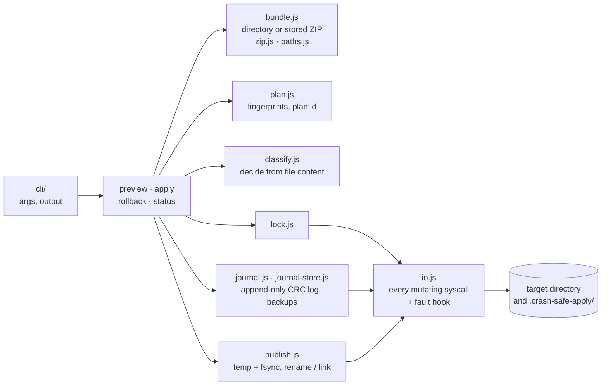
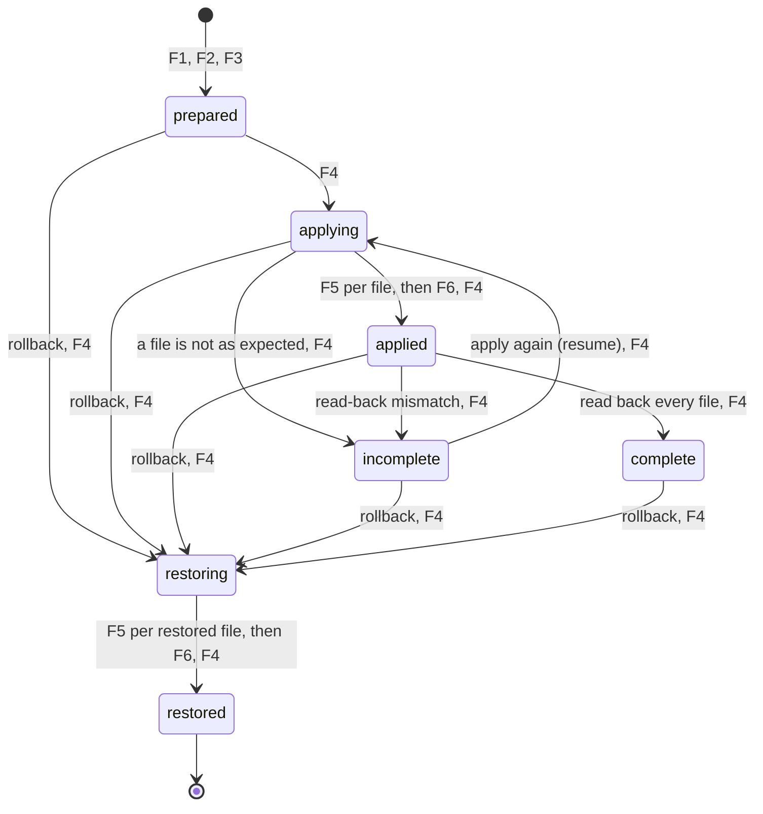
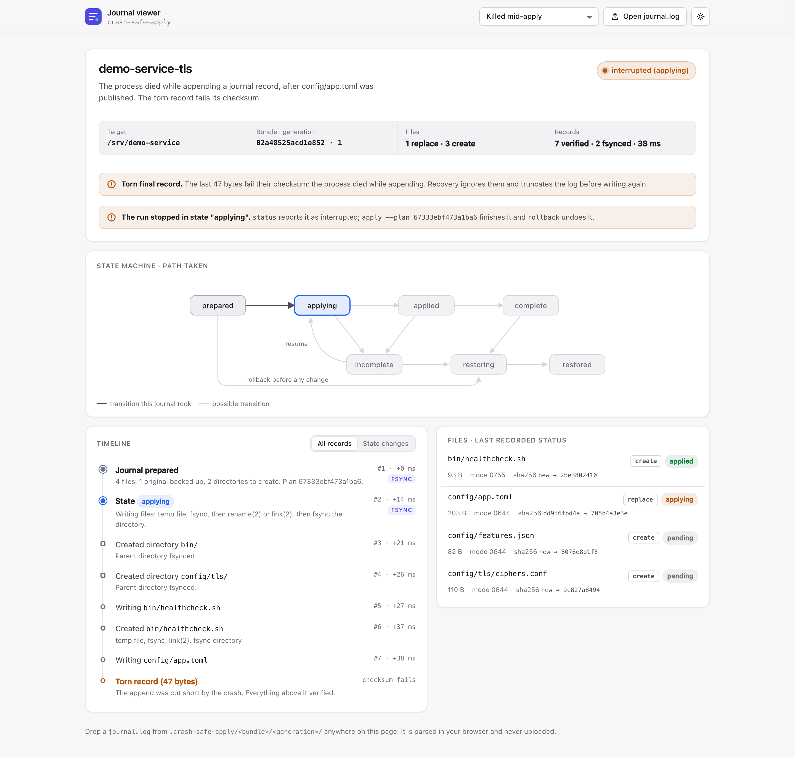
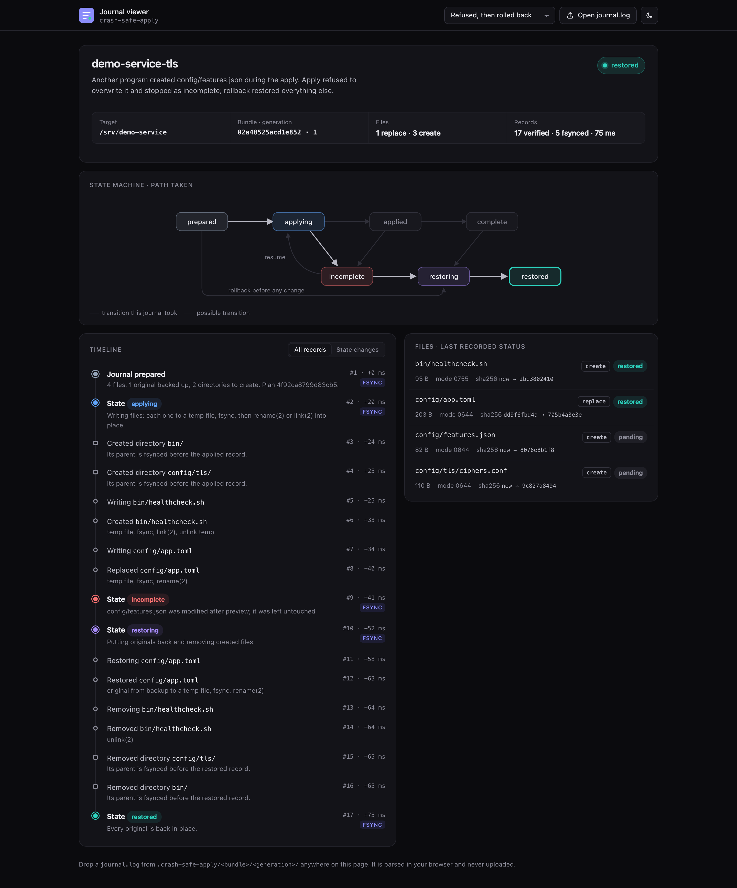
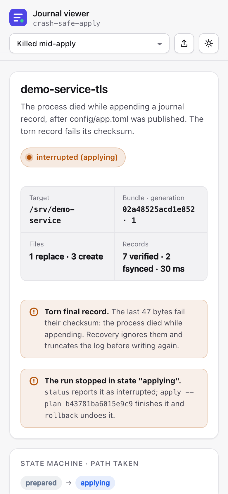
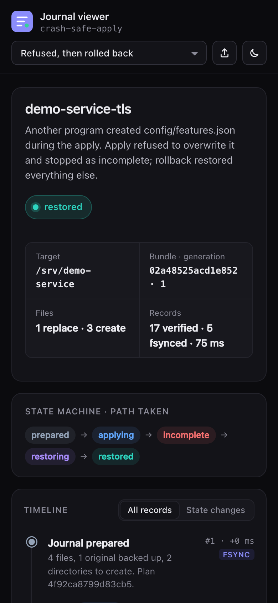

# crash-safe-apply

Preview, apply and roll back a bundle of file changes with a crash-consistent journal. If the process is killed or the power goes out at any point, the target directory ends up either fully applied or restorable to its original bytes, and files that changed between preview and apply are refused rather than overwritten. Zero runtime dependencies, Node 22+.



[](https://github.com/Nadimul96/crash-safe-apply/actions/workflows/ci.yml)
[](LICENSE)


## The problem

Installers, config-management runs and deploy scripts usually change files one at a time with plain writes. If the process dies halfway (a kill -9, an OOM kill, a laptop lid, a power cut), the machine is left with some files new, some old, maybe one truncated, and no record of which. Even tools that write a temp file and rename it often forget to fsync the file and its directory, so after power loss the "new" file can be empty or the old one can come back. And most tools overwrite whatever is on disk, including edits someone made after the change was reviewed. crash-safe-apply treats a set of file changes like a small database transaction: it writes a journal and backups first, publishes each file atomically, makes each step durable in the right order, and can always tell you exactly where it stopped and how to finish or undo it.

## Why it's interesting

- **Crash-tested after every syscall.** All writes, fsyncs, renames, links, unlinks and mkdirs go through one I/O layer ([`src/io.js`](src/io.js)) that calls a hook after each step. The fault matrix crashes a fresh copy of the scenario after each of those steps, including torn (half-written) writes, then checks recovery: **423 crash points, 512 recoveries, 0 failures** ([`docs/fault-matrix.md`](docs/fault-matrix.md)). Separate tests kill a real child process with SIGKILL at chosen steps and at random moments mid-apply ([`test/sigkill.test.js`](test/sigkill.test.js)).
- **The right primitive for each publish.** Replacements are written to a temp file, fsynced and `rename(2)`d over the old file, so the name never disappears. New files are published with `link(2)`, which the kernel refuses with `EEXIST` if anything appeared there in the meantime. Each touched directory is fsynced before the journal says "applied" ([`src/publish.js`](src/publish.js)).
- **An append-only, checksummed journal with a strict state machine.** One CRC-32-checked record per line, validated against a transition table on load; a torn final record is detected and truncated ([`src/journal.js`](src/journal.js)). A static viewer renders any journal as a timeline ([`viewer/`](viewer)).
- **Recovery decides from file content, not from the last log line.** Re-running apply converges, rollback restores originals, and a file edited after apply blocks rollback instead of being destroyed ([`src/classify.js`](src/classify.js)).
- **Time-of-check/time-of-use defenses.** The plan id is a digest of every target file's content, mode, device and inode, so `apply --plan <id>` refuses if anything changed since preview ([`src/plan.js`](src/plan.js)). Paths are walked with `lstat` and files opened with `O_NOFOLLOW`, so planted symlinks cannot redirect a write ([`src/fsutil.js`](src/fsutil.js)). The stored-ZIP reader cross-checks every header and CRC and is fuzzed with 4,000 mutated archives ([`src/zip.js`](src/zip.js), [`test/zip-fuzz.test.js`](test/zip-fuzz.test.js)).

## Quickstart

No keys, accounts or network access. Node 22+ on macOS or Linux.

```sh
git clone https://github.com/Nadimul96/crash-safe-apply && cd crash-safe-apply
node scripts/demo.js        # or: pnpm demo
```

The demo copies [`examples/`](examples) to a scratch directory and runs the real CLI: preview, an apply that the demo kills with SIGKILL after two files, status, rollback, and a `diff` against an untouched copy.

On your own files:

```sh
node scripts/make-manifest.js my-bundle --name my-change   # writes my-bundle/manifest.json
node bin/crash-safe-apply.js preview  my-bundle --target /path/to/dir
node bin/crash-safe-apply.js apply    my-bundle --target /path/to/dir --plan <id from preview>
node bin/crash-safe-apply.js status   my-bundle --target /path/to/dir
node bin/crash-safe-apply.js rollback my-bundle --target /path/to/dir
```

`pnpm install` is only needed for development tools (Biome, TypeScript, Playwright for screenshots). Add `--json` to any command for machine-readable output. Exit codes: 0 ok, 1 refused or failed, 2 usage error, 3 `status` says recovery is needed.

### Bundles

A bundle is a directory, or a stored (uncompressed) ZIP of one:

```
my-bundle/
  manifest.json
  files/
    config/app.toml
    bin/healthcheck.sh
```

```json
{
  "format": "crash-safe-apply/bundle@1",
  "name": "my-change",
  "files": [
    { "path": "config/app.toml", "sha256": "705b4a3e…" },
    { "path": "bin/healthcheck.sh", "sha256": "2be38024…", "mode": "0755" }
  ]
}
```

Every file under `files/` must be listed and must match its sha256. To make a ZIP: `cd my-bundle && zip -0 -r -X ../my-bundle.zip manifest.json files`. Without `mode`, a replaced file keeps its current permission bits and a new file gets 0644.

### As a library

```js
import { apply, preview, rollback, status } from "./src/index.js";

const plan = await preview({ bundle: "my-bundle", target: "/srv/app" });
plan.summary; // { create: 3, replace: 1, unchanged: 1, bytes: 488 }

const result = await apply({ bundle: "my-bundle", target: "/srv/app", plan: plan.id });
result.outcome; // "applied" | "resumed" | "already-applied" | "nothing-to-do"

const report = await status({ bundle: "my-bundle", target: "/srv/app" });
report.state; // "not-applied" | "in-progress" | "interrupted" | "incomplete" | "complete" | "restored"

await rollback({ bundle: "my-bundle", target: "/srv/app" });
```

Every refusal is a `CrashSafeError` with a stable `code` (`PLAN_MISMATCH`, `CHANGED_AFTER_PREVIEW`, `CONFLICT`, `UNSAFE_PATH`, `LOCKED`, …). Types are JSDoc, checked by `tsc` in strict mode; `pnpm build` emits `.d.ts` files to `dist/`. The package is not published to npm.

## How it works



Preview reads the bundle and the target and writes nothing. Apply takes a lock, then **prepares**: it copies every file it will replace into a new journal directory, writes the plan as the first journal record, fsyncs all of it, and renames the directory into place. Only then does it touch the target, one file at a time: write the new content to a temp file next to the destination, fsync it, re-check that the destination is still exactly what preview saw, and publish. After the last file it fsyncs every directory it touched, records `applied`, reads every file back, and records `complete`. Rollback walks the same journal in reverse, putting backed-up originals back with the same primitives.

State lives inside the target:

```
.crash-safe-apply/            mode 0700, owned by you
  lock                        holder's pid, host and command
  <bundle id>/<generation>/   a re-apply after rollback starts a new generation
    journal.log               one "<crc32> <json>" record per line
    originals/<n>             byte-for-byte copies of replaced files
```

### Journal state machine and fsync points



| Point | What is fsynced | Must be durable before |
|---|---|---|
| F1 | each backup in `originals/`, then the `originals/` directory | the plan is recorded |
| F2 | `journal.log` holding the `prepared` record, then the staging directory | the staging directory is renamed to its generation number |
| F3 | the bundle's journal directory, after that rename | anything in the target is touched |
| F4 | `journal.log`, after appending a state record | the step that depends on it (and before the CLI reports success) |
| F5 | each temp file holding new or original content | `rename(2)` or `link(2)` publishes it |
| F6 | every directory whose entries changed, once each, deepest first | the `applied` or `restored` record |

Per-file and per-directory progress records are appended without an fsync: recovery re-derives each file's state from its content, so a lost progress record costs nothing, and the next F4 makes it durable anyway. A crash leaves the journal in `prepared`, `applying`, `applied` or `restoring`; with no live lock holder, `status` reports that as **interrupted** and running `apply` or `rollback` again continues from what is on disk. A self-transition (`applying -> applying`, `restoring -> restoring`) records a resumed run.

## Guarantees and failure modes

| If the process dies or power is lost… | What is on disk afterwards | `status` | What finishes or undoes it |
|---|---|---|---|
| during preview | nothing was written, not even the state directory | `not-applied` | nothing to do |
| before the journal directory is renamed into place | target files untouched; a stray `.prepare-*` folder inside the state directory may remain (never read) | `not-applied` | apply again |
| after `prepared`, before the first publish | target files untouched; backups and plan durable | `interrupted` | `apply --plan` resumes; `rollback` marks it restored |
| while a temp file is being written | destination untouched; partial temp file next to it | `interrupted` | either command removes the temp |
| right after `rename(2)` of a replacement | process crash: new file in place. Power loss before F6: the old or the new file, complete, never missing or partial | `interrupted` | `apply` converges; `rollback` restores |
| right after `link(2)` of a new file | new file plus its temp | `interrupted` | either command removes the temp |
| while appending a journal record | torn record fails its CRC and is ignored; it is truncated before the next append | previous state | as above |
| after `applied`, before `complete` | everything published and durable | `interrupted` | `apply` verifies and completes |
| during rollback | some originals back, other files still new | `interrupted` (rollback) | `rollback` again; `apply` refuses until then |
| something else edits the target between preview and apply | unchanged; nothing was written | `not-applied` | apply refuses with `PLAN_MISMATCH`; preview again |
| something else edits a file during apply | that file is left untouched; earlier files are applied | `incomplete` | `rollback` restores the rest and leaves that file alone |
| someone edits an applied file, then runs rollback | unchanged; rollback refuses before touching anything | `complete` (with a blocker) | save the edit, put back the applied content or delete the file, retry |

**Assumptions (POSIX).** `rename(2)` atomically replaces a name; `link(2)` fails with `EEXIST` when the name exists; `fsync` on a file makes its data durable and `fsync` on a directory makes its entries durable. The target and its state directory are on one local filesystem with hard links. On macOS, Node's `fsync` is implemented with `F_FULLFSYNC`, which also flushes the drive's write cache (measured on this machine: 4.1 ms per Node fsync of a 4 KiB file, 4.5 ms for `F_FULLFSYNC` from C, 0.08 ms for plain `fsync`).

**What it does not protect against.**

- Storage that acknowledges a flush without persisting it (drives or virtual disks without power-loss protection that ignore cache flushes). No software can fix that.
- A concurrent writer in the last microseconds between the final check and `rename(2)`: POSIX has no compare-and-swap rename, so that write can be lost. Writers outside that window are detected and the file is refused.
- A parent directory swapped for a symlink between the `lstat` walk and the syscall. Node exposes no `openat`/`RESOLVE_BENEATH`, so the walk is repeated right before each use to keep the window small.
- Anyone running as your user: the journal is validated, paths re-checked and backups hash-verified, but your own uid can change anything you can.
- Authenticity: sha256 values check that bundle content matches its manifest, not who wrote it.
- Ownership, ACLs, extended attributes and timestamps are not restored. Files owned by another user, or with setuid, setgid or sticky bits, are refused.
- Windows: refused at startup. NFS and other network filesystems: a lock held from another host is never broken automatically, and hard links may be unsupported.

## Design decisions

1. **An append-only journal, not a receipt rewritten each step.** The code this was extracted from rewrote a JSON receipt with temp file and rename after every step: two fsyncs per update and quadratic bytes written over a run. Appending one checksummed line costs one fsync, keeps every transition (the viewer's timeline is the log itself), and a torn append is detectable by its CRC. The price is torn-tail handling: the log ends at the first record that fails its checksum, and that tail is truncated before anything new is appended. The one step that does use rename is publishing the generation directory, because it makes "backups and plan are durable" a single atomic event.
2. **Recovery classifies files by content.** The alternative, trusting the last per-file record, would need an fsync per record and an exact replay of what each record meant. Instead every file is classified as original, installed, missing or modified, using strict identity (sha256, size, mode, device, inode) within a run and content identity after a crash, since device numbers can change across a reboot. That makes apply and rollback idempotent and lets per-file records go unsynced.
3. **Fsync the directory, once per run.** Fsyncing the file is not enough: on Linux filesystems a new or renamed name is not durable until its directory is fsynced. The first version fsynced after every file. Because recovery is content-based, a publish whose directory entry is lost to power loss simply reads as original again, so each touched directory is now fsynced once before `applied`: for 500 files that is 16 directory fsyncs instead of 510.
4. **`link(2)` for creates, `rename(2)` for replacements.** The original code unlinked the old file and then linked the new one, leaving the path missing for a moment and, after a crash, possibly for good. `rename(2)` replaces atomically. Using `rename(2)` for creates too would silently overwrite a file that appeared after the check; `link(2)` gets the kernel to refuse instead. (`renameat2(RENAME_NOREPLACE)` and `renamex_np(RENAME_EXCL)` do this in one call, but Node does not expose them.) The cost is needing a filesystem with hard links.
5. **`O_NOFOLLOW`, `O_EXCL` and an `lstat` walk for every path.** Checking `path.resolve(p).startsWith(target)` does nothing against a symlink planted inside the target. Each path is walked component by component with `lstat`, symlinks are refused, and every file we create is opened with `O_EXCL | O_NOFOLLOW`, so a pre-planted file or link at a temp name cannot be written through.
6. **Refuse instead of overwrite.** There is no `--force`. A plan id makes "what you approved is what runs"; a file that changed is left exactly as it is and the run stops in a state that `status` explains and `rollback` undoes. Nothing in the tool can destroy bytes it did not write.

## Journal viewer

[`viewer/index.html`](viewer/index.html) renders a `journal.log` as the state-machine path it took, a timeline of records (fsynced ones marked) and each file's last status. It verifies every record's CRC-32 in the browser, shows torn tails, escapes all journal content, and works straight from `file://` with no build step. Open it and drop a journal from `.crash-safe-apply/<bundle>/<generation>/`, or pick one of the samples, which [`scripts/viewer-samples.js`](scripts/viewer-samples.js) produces from real runs.



<p>
  
  
  
</p>

## Proof

Measured on 2026-10-12 on an Apple M1 MacBook Pro (macOS 26.5, APFS, Node 22.22.0).

| What | Result | Reproduce |
|---|---|---|
| Test suite (`node:test`, offline) | 120 tests pass in about 80 s; the time is almost all `F_FULLFSYNC` | `pnpm test` |
| Fault-injection matrix | 423 crash points (66 right after an fsync, 101 torn writes), 512 recoveries checked, 0 failures | `pnpm fault-report` |
| Real `kill -9` | 6 chosen steps × (rollback, re-apply) plus 8 kills mid-apply of a 40-file bundle; all recover | `node --test test/sigkill.test.js` |
| ZIP fuzzing | 4,000 mutated archives (seed `5eedc5a`): every one either rejected with a typed error or parsed with all invariants holding | `node --test test/zip-fuzz.test.js` |

Throughput, 4 KiB files, half replacing existing files and half new (`pnpm bench`, median of 3):

| Files | apply | file fsyncs | dir fsyncs | rollback | file fsyncs | dir fsyncs |
|--:|--:|--:|--:|--:|--:|--:|
| 10 | 264 ms | 19 | 16 | 102 ms | 7 | 6 |
| 100 | 1,857 ms | 154 | 16 | 1,394 ms | 52 | 6 |
| 500 | 9,944 ms | 754 | 16 | 5,801 ms | 252 | 6 |

Apply needs one fsync per new file, one per backed-up original and one per state record; at roughly 13 ms per `F_FULLFSYNC` under this load, that is the whole cost. Linux filesystems with a plain `fsync` are typically much faster; the numbers above are for this machine only.

## Configuration

Nothing is required. The CLI reads no config files and needs no keys.

| Variable | Required | Default | What it does |
|---|---|---|---|
| `NO_COLOR` | no | unset | Disable colored output |
| `FORCE_COLOR` | no | unset | Force colored output even when piped (`0` disables) |
| `CHROMIUM_PATH` | only for `pnpm media:screenshots` | newest Playwright headless shell in the local cache | Browser used to screenshot the viewer |
| `FAULT_MATRIX_CONCURRENCY` | no | `8` | Crash points run in parallel by the fault matrix |

Library calls accept `limits` (defaults: 1,000 files, 16 MiB per file, 64 MiB per bundle, 1 MiB manifest), because a bundle and the originals it replaces are held in memory.

## Development

```sh
pnpm install            # dev tools only; there are no runtime dependencies
pnpm lint               # Biome
pnpm typecheck          # tsc --noEmit over JSDoc types, strict
pnpm test               # everything, including the fault matrix and kill -9 tests
pnpm build              # emit .d.ts files to dist/
pnpm demo               # live demo
pnpm fault-report       # regenerate docs/fault-matrix.md
pnpm bench              # throughput table
pnpm viewer:samples     # regenerate viewer/samples.js from real runs
pnpm media:demo         # re-record docs/media/demo.svg
pnpm media:screenshots  # re-capture the viewer screenshots
```

Source map: [`src/apply.js`](src/apply.js), [`src/rollback.js`](src/rollback.js) and [`src/status.js`](src/status.js) are the entry points; [`test/support/fault-matrix.js`](test/support/fault-matrix.js) is the crash harness.

## Status and limitations

A working, heavily tested tool, but young: it has not been used on production fleets. It supports creating and replacing files, not deleting them. It is POSIX-only (macOS, Linux and the BSDs; Windows is refused). It holds the bundle and the originals in memory. Rollback restores content and permission bits, not ownership, ACLs, extended attributes or timestamps. A stale lock left by a crash is cleared with rename-and-verify rather than an OS lock (Node has no `flock`), which narrows but does not fully close a race between several runs starting at the same instant. The crash tests model process death; protection against power loss rests on the fsync ordering above and on storage that honors flushes.

## License

MIT, see [LICENSE](LICENSE).
